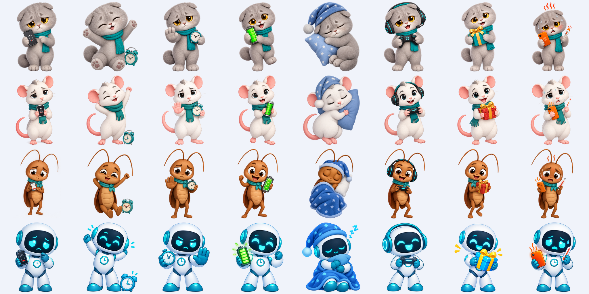
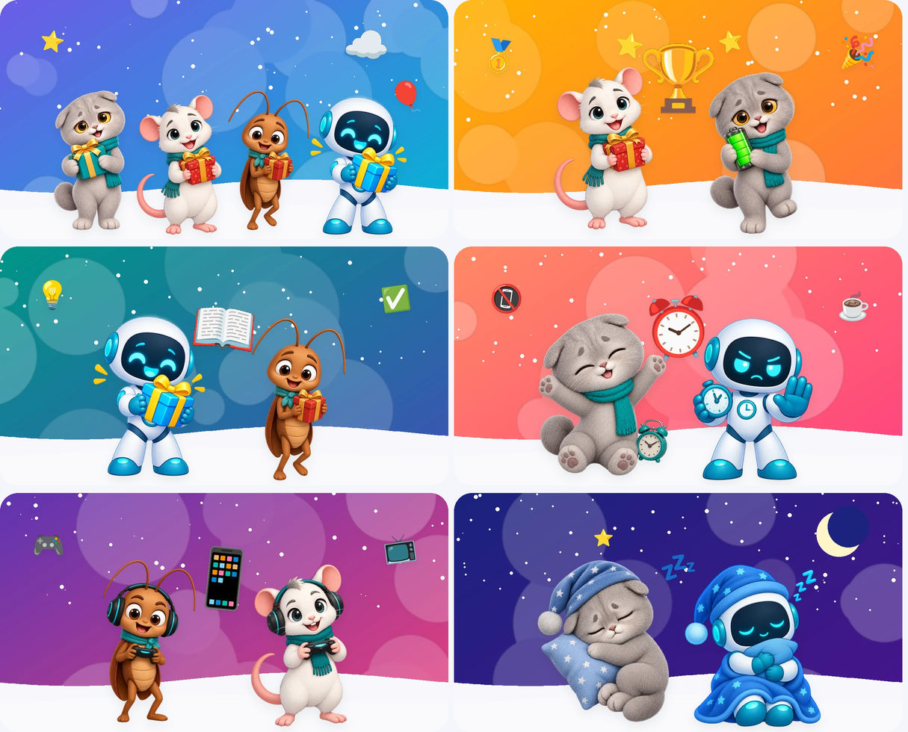
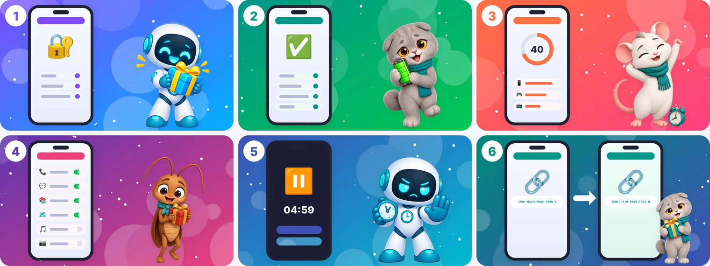
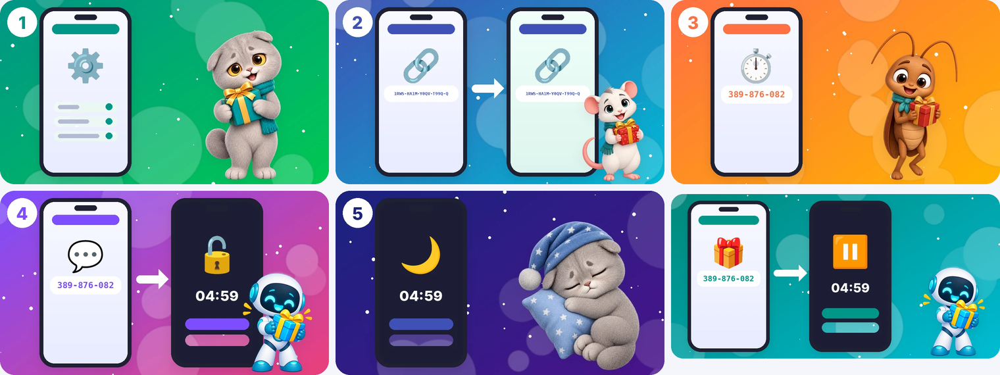

# Хранитоникс + Хранитоникс Бокс

Два Android-приложения в одном репозитории:

| Модуль | Приложение | Для кого | Пакет |
|---|---|---|---|
| `app/` | **Хранитоникс** | телефон ребёнка | `com.khranitoniks.guard` |
| `box/` | **Хранитоникс Бокс** | телефон родителя | `com.khranitoniks.box` |



## Что нового в 1.2



**Исправлено: «сидел в Instagram, а время не шло».** В 1.1 дневной лимит считал только приложения из списка (TikTok, Likee, Roblox), а «Контроль доступа к устройству» был выключен по умолчанию и спрятан в настройках. Теперь:

- **Лимит по умолчанию считается для всего телефона** — любое приложение тратит время, кроме *разрешённых* (звонки, SMS, контакты, рабочий стол, клавиатура и то, что выбрал родитель). Режим «Только выбранные приложения» остался как опция.
- Время считается двумя способами сразу (посекундный счётчик службы + системная статистика Android) — берётся максимум, поэтому время не теряется, даже если прошивка ненадолго «усыпила» защиту.
- Старый «Контроль доступа» перенесён автоматически: если он был включён, его минуты/сеансы/перерывы стали дневным лимитом и перерывами.
- Исправлено: системные Настройки на некоторых телефонах считались «рабочим столом» (FallbackHome) и не блокировались.
- На главном экране появилась карточка **«Защита работает»**: видно, жива ли служба и как Хранитоникс видит последнее открытое приложение (⏱ считается / ✅ разрешено / ⛔ заблокировано).

**Приложения и правила** (Главная → «Управлять» или Настройки, по PIN):
- удаление любого приложения из списка кнопкой 🗑 (в т. ч. TikTok, Likee, Roblox; есть кнопка «Вернуть»);
- **личный лимит** для каждого приложения (например, TikTok — 30 мин);
- **разрешённые всегда** и **чёрный список** (запрещено всегда, временно открыть — по PIN на 15/60 мин).

**Новое:**
- современный интерфейс: градиентные карточки, кольцо оставшегося времени, плитки статуса, тёмная тема;
- большая заметная кнопка **«🎁 Время по коду»** на главном экране и на экране блокировки;
- **имя ребёнка**: приложение, экраны блокировки и уведомления обращаются по имени («Маша, пора сделать перерыв»);
- **учебное время** по дням недели;
- **награды** — 8 медалей (серия дней в рамках лимита, перерывы, зарядка, коды…);
- **инструкция** с картинками и частыми вопросами прямо в приложении;
- **коды-действия** из Бокса: снять ночь на час/до утра, закончить перерыв, разрешить телефон на зарядке, снять учёбу, открыть настройки на 10 мин. Коды времени остались совместимы со старыми версиями.

**Хранитоникс Бокс 1.2:** новый дизайн, аватары детей, статистика «выдано сегодня / за неделю», **задания-награды** («Сделал уроки» → +30 мин, свой список), коды-действия, история с фильтром по детям, большой код в окне с кнопками «Копировать / SMS / Отправить», инструкция из 5 шагов и FAQ.





> Иллюстрации собраны из персонажей скриптом `graphics-src/scenes.py` (`python3 graphics-src/scenes.py`).
> Строки: `python3 graphics-src/strings_gen.py app/src/main/res graphics-src/strings_core.py graphics-src/strings_ui.py graphics-src/strings_v12.py` и
> `python3 graphics-src/strings_gen.py box/src/main/res graphics-src/strings_box.py graphics-src/strings_box_v12.py`.

---

## 1. Как собрать APK через GitHub (без Android Studio)

1. Зарегистрируйтесь или войдите на <https://github.com>.
2. Нажмите **«+» → New repository**. Название, например, `khranitoniks`. Можно сделать репозиторий **Private**. Галочки README/.gitignore **не ставьте**. Нажмите **Create repository**.
3. Распакуйте архив `Khranitoniks.zip` на компьютере.
4. На странице пустого репозитория нажмите ссылку **«uploading an existing file»**.
5. Откройте распакованную папку `Khranitoniks`, выделите **всё её содержимое** (`app`, `box`, `.github`, `build.gradle.kts`, `settings.gradle.kts`, `gradle.properties` и т. д.) и перетащите в окно браузера.
   - ⚠️ Папка `.github` скрытая. В Windows включите «Вид → Скрытые элементы», в macOS нажмите `Cmd + Shift + .`.
   - Перетаскивайте именно содержимое: в корне репозитория должны лежать `settings.gradle.kts` и папка `.github`, а не папка `Khranitoniks`.
6. Внизу нажмите **Commit changes** (ветка `main`).
7. Откройте вкладку **Actions**. Сборка «Build APK» запустится сама (если GitHub спросит, нажмите *I understand… enable workflows*). Запустить сборку вручную можно так: **Actions → Build APK → Run workflow**.
8. Сборка идёт примерно 5–10 минут. Когда появится зелёная галочка, откройте запуск и пролистайте вниз до раздела **Artifacts**:
   - `app-debug-apk` — Хранитоникс (телефон ребёнка);
   - `box-debug-apk` — Хранитоникс Бокс (телефон родителя).
9. Скачайте zip-архивы, распакуйте их и перенесите `.apk` на телефоны. При установке разрешите «Установку из неизвестных источников».

> Если сборка упала (красный крестик), откройте запуск → шаг **Build debug APKs**, скопируйте последние 50–100 строк лога и пришлите — я исправлю.

Альтернатива через командную строку:
```bash
git init && git add . && git commit -m "Хранитоникс"
git branch -M main
git remote add origin https://github.com/<ваш-логин>/khranitoniks.git
git push -u origin main
```

Workflow (`.github/workflows/build-apk.yml`): JDK 17 (Temurin) → Gradle 8.10.2 через `gradle/actions/setup-gradle@v4` (wrapper не нужен) → `gradle assembleDebug --stacktrace` → загрузка APK.

---

## 2. Первая настройка на телефоне ребёнка (Хранитоникс)

1. Установите и откройте приложение. Мастер настройки проведёт по шагам: **PIN (4 цифры) → 4 разрешения → персонаж**.
2. Выдайте разрешения: статистика использования, поверх других приложений, без оптимизации батареи, уведомления.
3. **Настройки (по PIN) → Защита:**
   - «Включить защиту от удаления» — приложение становится *администратором устройства*. Пока переключатель включён, Android не даёт удалить приложение (Samsung, Huawei, Honor, Infinix, Tecno, Xiaomi и другие).
   - «Защитить Настройки телефона PIN-кодом» — без PIN ребёнок не откроет системные Настройки и не выключит администратора.
   - «Открыть настройки автозапуска» — **обязательно на Huawei/Honor, Infinix/Tecno, Xiaomi**, иначе прошивка может «усыпить» защиту. Подсказка для вашего бренда показывается прямо в приложении.
4. **Связь с Боксом:** Настройки → «Связь с Хранитоникс Бокс» → «Создать новый ключ» → ключ вида `1RWS-HA1M-Y0QV-T99Q-Q` (17 символов).

## 3. Хранитоникс Бокс (телефон родителя)

1. «Добавить ребёнка» → имя → «Ввести ключ» → ключ с телефона ребёнка. Есть и обратный вариант: «Создать ключ» в Боксе, затем на телефоне ребёнка выбрать «Ввести ключ из Бокса».
2. Чтобы дать время: выберите ребёнка и вариант (+10…+180 мин или «Без ограничений сегодня»). Бокс покажет 9-значный код, например `389-876-082`, и время, до которого он действует. Код можно продиктовать, **скопировать** (только код или готовое сообщение с текстом), отправить по SMS или в любой мессенджер. Любой код из истории копируется нажатием.
3. Ребёнок нажимает **«Время (код от родителя)»** на экране блокировки или **«Время по коду»** на главном экране и вводит код — или нажимает **«Вставить код из буфера»**, если код пришёл сообщением (код находится в любом тексте: `389-876-082`, `389 876 082`, «Код: 389876082»).
4. Ключ сопряжения можно скопировать и вставить с обеих сторон (Бокс ↔ телефон ребёнка), набирать его вручную не нужно.

**Как устроены коды:** код подписан общим ключом (HMAC-SHA256) и содержит выбранный вариант времени. Без ключа подделать код нельзя. Код работает **без интернета**, действует **24 часа** и только **один раз**. После 3 неверных попыток ввод блокируется на 60 секунд, а попытка записывается в журнал.

---

## 4. Что умеет Хранитоникс

- **Главный экран:** время экрана за сегодня, шкала дневного лимита, карточки TikTok / Likee / Roblox и любых добавленных приложений (кнопка «Открыть»; если приложение не установлено — «Не установлено»), время до перерыва, статус зарядки и ночного режима, плашка о недостающих разрешениях.
- **Подсчёт времени:** `UsageStatsManager.queryEvents()` с 00:00, пары RESUMED/PAUSED. Экран: `SCREEN_ON/OFF` и сверка с `SCREEN_INTERACTIVE/NON_INTERACTIVE`.
- **Перерывы и лимит:** перерыв каждые N минут, дневной лимит. Мягкий режим — громкое уведомление, строгий — полноэкранный оверлей с отсчётом. По PIN выдаются бонусы +10 / +15 / +30 минут или «Снять ограничение до конца дня».
- **Зарядка до 80%:** оверлей показывает процент, прогресс, температуру и предупреждение о перегреве >42 °C. «Срочно разблокировать» по PIN: на 5 минут, на 15 минут или до отключения кабеля. При 80% звучит сигнал и приходит уведомление. Если кабель отключили раньше, в журнал пишется «Зарядка прервана на XX% в ЧЧ:ММ».
- **Блокировку нельзя свернуть:**
  - в строгом режиме запрещённое приложение сразу отправляется в фон (видео и игра останавливаются), а экран блокировки остаётся поверх рабочего стола и «Недавних», пока ребёнок не нажмёт «Понятно, на главный экран». Повторно открыть TikTok из «Недавних» не получится — экран блокировки появится снова за полсекунды;
  - кнопка «Назад» не снимает блокировку (окно блокировки забирает её себе);
  - «Картинка в картинке», разделённый экран и плавающие окна тоже отслеживаются (Android 10+): если запрещённое приложение видно хоть в маленьком окне, включается блокировка;
  - проверка идёт каждую секунду, а при активной блокировке — каждые полсекунды;
  - сворачивание можно отключить: Настройки → Лимиты → «Сворачивать запрещённое приложение».
- **Звонки:** во время обычного звонка оверлеи скрываются. Но если во время звонка (в том числе в Discord/Telegram) на экране запрещённое приложение, блокировка работает — звонок больше не служит «ключом».
- **Замок настроек** закрывает не только «Настройки», но и «оптимизаторы» производителей (Samsung Device Care, Huawei/Honor Диспетчер, Phone Master, Безопасность Xiaomi, OPPO/vivo/OnePlus, Digital Wellbeing), через которые можно было усыпить защиту.
- **Низкий заряд:** при ≤15% уведомление приходит каждые 2 минуты (отключается в настройках).
- **Персонажи (новые объёмные иллюстрации):** Сёма (серый шотландский вислоухий кот), Тимма (белый крыс), Таракан Олежка, Робот Хронитоникс — все в бирюзовых шарфиках. У каждого 8 сюжетов: низкий заряд, перерыв, лимит, зарядка завершена, ночной режим, игровой режим, награда, перегрев. Показываются на экранах блокировки, в уведомлениях и в приложении.
- **Ночной режим** 21:00–07:00: можно включать и выключать, разблокировка по PIN.
- **Статистика за 7 дней:** столбчатый график на Canvas. Нажмите на день, чтобы увидеть подробности. Можно включить показ всей активности: все запущенные приложения и время в них.
- **Журнал событий:** зарядки, разблокировки, бонусы, коды, ошибки PIN.
- **Контроль доступа ко всему устройству:** например, всего 40 минут в день, сеансами по 10 минут с перерывами по 5 минут. В перерыве и после исчерпания времени работают только разрешённые приложения, звонилка, SMS и лаунчер.
- **Память и очистка:** ОЗУ и хранилище, выгрузка фоновых процессов, поиск мусора (временные файлы, логи, миниатюры, пустые папки, APK в «Загрузках»), системная очистка кэша.
- **Игровой режим:** включает «Не беспокоить», выгружает фоновые приложения и повторяет это каждые 2 минуты, пока идёт игра. VPN-приложения определяются автоматически по `VpnService`, прокси-клиенты — по названию. Они, а также приложения из списка исключений, не трогаются.
- **Темы оверлея:** тёмная, светлая, неон. Тексты напоминаний можно задать свои.
- **Языки:** русский и английский (на Android 13+ язык можно выбрать отдельно для приложения).

## 5. Честно об ограничениях Android

- **Защита от удаления** через администратора устройства работает на всех брендах. Но её можно обойти сбросом телефона к заводским настройкам или загрузкой в безопасный режим: это ограничение Android, а не приложения. Полная защита возможна только в режиме Device Owner (через ADB на телефоне без аккаунтов).
- **Игровой режим без root** не может «заморозить» чужие приложения. Он выгружает их кэшированные фоновые процессы (`killBackgroundProcesses`), и некоторые прошивки сразу перезапускают свои сервисы.
- **Очистка мусора** на Android 11+ не имеет доступа к `Android/data` других приложений. Для кэша всех приложений используется системный запрос Android.
- На Huawei, Infinix и Xiaomi без включённого автозапуска прошивка может останавливать фоновую защиту.

## 6. Структура проекта

```
.github/workflows/build-apk.yml   сборка на GitHub Actions
settings.gradle.kts, build.gradle.kts, gradle.properties
app/   Хранитоникс
  core/      настройки, подсчёт времени, статистика, журнал, PIN, коды, разрешения
  service/   ForegroundService (specialUse), оверлей на View/XML, уведомления, автозапуск
  admin/     администратор устройства (защита от удаления)
  tools/     память, очистка, игровой режим
  ui/        Jetpack Compose (Material 3)
  res/drawable-nodpi/char_*.webp   32 картинки персонажей (512×512, прозрачный фон)
  res/drawable/ic_launcher*.xml
box/   Хранитоникс Бокс (Compose)
graphics-src/   генератор строк RU/EN (strings_*.py); art.py — старые векторные персонажи, больше не используются
  python3 graphics-src/strings_gen.py app/src/main/res graphics-src/strings_core.py graphics-src/strings_ui.py
  python3 graphics-src/strings_gen.py box/src/main/res graphics-src/strings_box.py
```

Версии: Kotlin 2.0.21 + Compose plugin, AGP 8.7.3, Gradle 8.10.2, compileSdk/targetSdk 35, minSdk 26, Compose BOM 2024.12.01.
